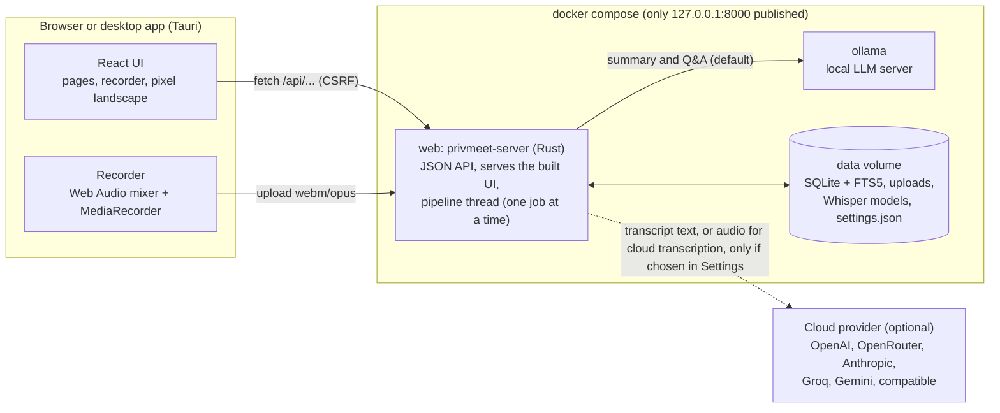
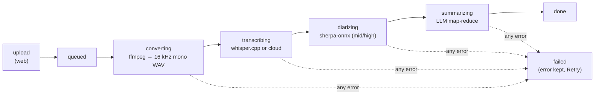
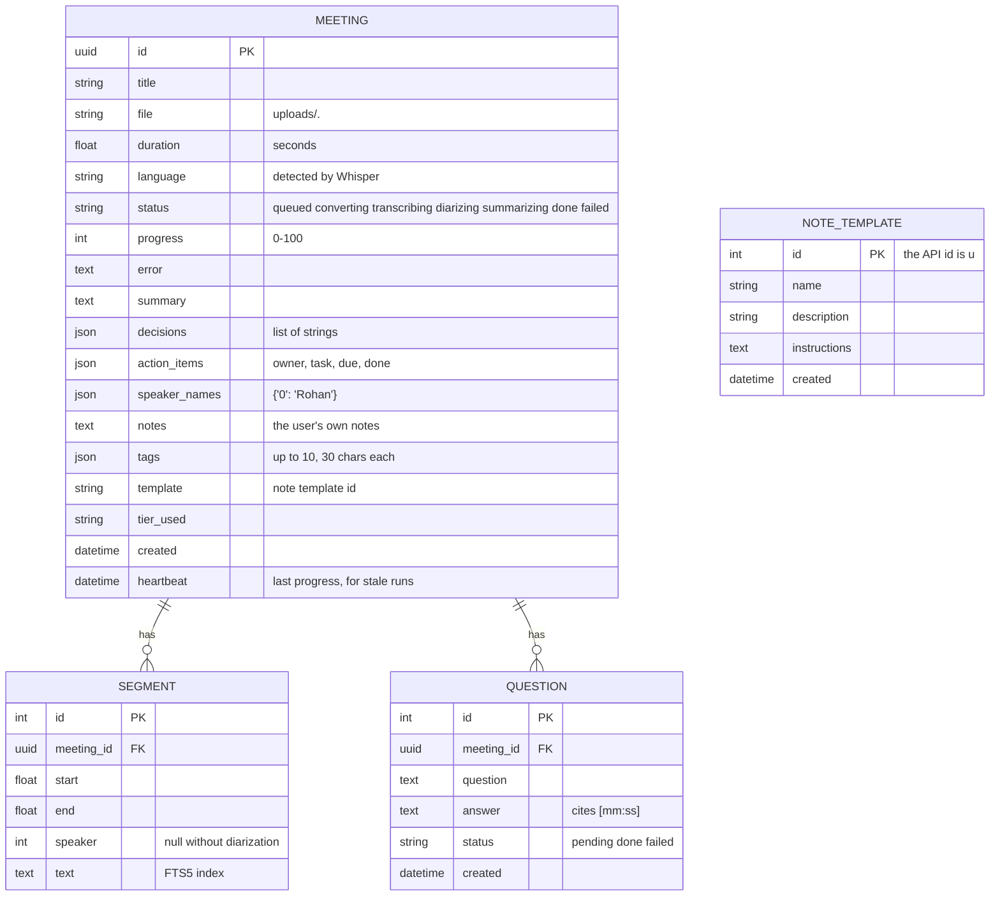

# PrivMeet architecture

PrivMeet turns a meeting recording into a transcript with speakers, a summary, decisions, action items, search and Q&A. Everything runs on the user's machine. This document describes:
- the parts of the system
- the path a recording takes through them
- how the system stays inside the memory of a low-end laptop
- the data it stores

The backend is one Rust program, `privmeet-server` (`native/server`): the API, the web app and the pipeline in a single process, with SQLite for storage and no other service but Ollama. [TECH_STACK.md](TECH_STACK.md) says why each piece was chosen and [BENCHMARKS.md](BENCHMARKS.md) has the numbers.

## Components

| Part | Technology | Job |
|---|---|---|
| UI | React 19 + Tailwind 4 (Vite build) | Pages: Home, Meetings, New Meeting, Meeting detail, Record / Live, Templates, Models, Settings. Polls the API every 2 s while a meeting is processing; there are no websockets. |
| Recorder | Web Audio + `MediaRecorder` | Mixes the mic with a shared tab's audio (`getDisplayMedia`) into one stream, records `audio/webm;codecs=opus`, uploads on stop. |
| Desktop app | Tauri 2 (system webview) | Launcher page: checks Docker, runs `docker compose up -d` with the bundled `compose.yml` (+ `compose.gpu.yml` on NVIDIA), opens the app, stops the stack on quit. Grants mic/camera to `127.0.0.1:8000` only. |
| web | Rust: axum + tokio, rusqlite (SQLite with FTS5), whisper-rs (whisper.cpp), sherpa-rs (sherpa-onnx), reqwest | Upload validation, the meetings API, settings, search, exports, serving the built UI, and the pipeline on one background thread. |
| ollama | Ollama | Serves the qwen2.5 model of the tier; at most one model loaded. |

Module map of `native/server/src`: `web.rs` (router, `FEATURES`, Host check), `csrf.rs`, `api.rs` (meetings), `templates.rs`, `models.rs` (Models page, Test Connection), `export.rs`, `db.rs` (schema, migrations), `meetings.rs`, `settings.rs`, `hw.rs` (tiers), `pipeline.rs` (job queue, stages, Q&A), `audio.rs` (ffmpeg), `stt.rs`, `diarize.rs`, `names.rs`, `llm.rs`, `providers.rs`, `cli.rs` (`seed-demo`, `import-django`, `process-file`).

## The pipeline
`pipeline.rs: process_meeting(id)` runs these stages strictly one after another on the pipeline thread. Each stage updates the meeting's `status` and `progress` (and a heartbeat), and the UI shows them as it polls.

1. **Upload (web).** The upload is checked before it is stored:
   - extension allow-list
   - size limit (`MAX_UPLOAD_MB`), enforced while the body streams in
   - `ffprobe` must find an audio stream

   The file gets a random name, a meeting row is created in `queued`, and the job is put on the queue.
2. **Converting.** `audio.rs` runs `ffmpeg` (`Command` with list arguments, never a shell) to a temporary 16 kHz mono WAV. Every later stage reads that file, and it is deleted at the end whatever happens.
3. **Transcribing.** `stt.rs` runs whisper.cpp with the tier's ggml model, downloaded into `MODELS_DIR/whisper-cpp` on first use, or sends the audio in FLAC chunks to the cloud provider when cloud transcription is on.
   - Known names (the user's, saved speaker names, the Settings vocabulary) go into Whisper's prompt, and `names.rs` corrects near-miss spellings afterwards.
   - Lines Whisper writes into silence are dropped.
   - Progress follows whisper.cpp's own progress callback.
4. **Diarizing** (on unless the tier is `low`). `diarize.rs` runs sherpa-onnx (pyannote segmentation + a CAM++ speaker embedding, about 35 MB of ONNX). Each transcript segment gets the speaker whose turns overlap it most, and speakers are renumbered in order of appearance.
5. **Summarizing.** `llm.rs` calls Ollama's `/api/chat`, or the chosen cloud provider (`providers.rs`), over plain HTTP:
   - **Map:** the transcript is split into chunks of about 1,500 tokens. Each chunk becomes `TOPIC / DECISION / TASK: owner | task | due` lines; small models stay accurate on short chunks.
   - **Reduce:** one call writes the JSON `{summary, decisions, action_items}`. For a long meeting it reads the map notes; for a short one, the transcript itself. The meeting's note template adds what the summary should focus on.
   - **Repair:**
     - Decisions and tasks are taken from the map lines, so the reduce step cannot drop them.
     - A loose or cut-off JSON reply is repaired.
     - Owners and due dates that never appear in the transcript are blanked (no invented names or deadlines).
   - **Budget:** every Ollama call caps its reply, so prompt plus reply always fit `num_ctx`.
6. **Done** or **failed**. On any error the text is stored, the status becomes `failed`, and the UI offers Retry. After every job the server calls `malloc_trim`, so the memory Whisper and ONNX freed goes back to the system.

**Q&A** (`answer_question`) goes through the same queue, so it never runs next to a transcription.
- The excerpts are the whole timestamped transcript when it fits.
- Otherwise they are the best FTS5 hits (bm25 rank), each with the lines that follow it, because a topic is raised before it is decided.
- The answer must cite `[mm:ss]`. When the model leaves the citation out, the timestamps of the best-matching lines are added. An answer that shares nothing with the excerpts becomes "The meeting does not say."

**Search** (`GET /api/meetings/?q=`) matches title, notes and summary, plus the transcript through SQLite's FTS5 index (kept in step with the segments by triggers), and returns the matching lines with their timestamps, best first.

## Resource strategy
PrivMeet has to run on a laptop with about 6 GB of RAM and no GPU, and still use an NVIDIA GPU when there is one.

1. **A hardware tier, picked at start-up.** `hw.rs`:
   - reads the total RAM (`/proc/meminfo`),
   - checks for CUDA (a binary built with the `cuda` feature, and `nvidia-smi` answering),
   - reads the VRAM through `nvidia-smi`.

   The tier sets the Whisper model, the LLM and its context, the beam size and whether diarization runs. Env variables and then the Settings page override it. Settings are re-read at the start of every job, so a change applies to the next meeting with no restart.

   | | low | mid | high |
   |---|---|---|---|
   | Trigger | < 7.5 GB, no GPU | ≥ 7.5 GB, no GPU | NVIDIA GPU |
   | Whisper | base, CPU, beam 1 | small, CPU, beam 5 | large-v3-turbo, CUDA |
   | LLM | qwen2.5:1.5b, ctx 4096, unloads after 30 s | qwen2.5:3b, ctx 8192 | qwen2.5:7b, or 3b under 6 GB VRAM |
   | Diarization | off | on | on |
2. **One heavy model in memory at a time.**
   - One pipeline thread takes jobs from a queue: meetings, questions and model downloads, one at a time.
   - Inside a job the stages are sequential, and the Whisper model is dropped before diarization starts.
   - Ollama runs with `OLLAMA_MAX_LOADED_MODELS=1` and `OLLAMA_NUM_PARALLEL=1`.
   - Measured: the whole server peaks at about 0.5 GB during a local run with diarization and settles at about 40 MB afterwards (`docs/BENCHMARKS.md`).
3. **CPU politeness.** Whisper uses half the cores by default, so the desktop and the web UI stay responsive.
4. **A light runtime.**
   - One process with no interpreter: about 15 MB idle, a 5 MB binary plus the sherpa-onnx libraries.
   - The UI is built to static files at image build time and served by the same process, with no Node server.
   - Progress is plain polling, with no websockets.
   - SQLite in the data volume instead of a database server; no message broker.
5. **Light diarization.** ONNX models through sherpa-onnx instead of pyannote on PyTorch: tens of megabytes instead of gigabytes.
6. **Long meetings on small models.** Map-reduce with chunk sizes worked out from `num_ctx`, so a one-hour meeting fits a 4k-context model (see "The pipeline").

## Data model

- **The database** is `DATA_DIR/privmeet.sqlite3`; `db.rs` holds the schema as a list of migrations applied in order at start-up.
- **Uploads** live in the `data` volume under random file names and are only ever served through `GET /api/meetings/<id>/audio`, which supports HTTP Range so the player can seek. Deleting a meeting deletes its file and its converted copies. Segments and questions go with it (cascade).
- **Settings** are not in the database. They are `DATA_DIR/settings.json`, written atomically (temp file + rename) by `settings.rs`, which validates every key and never returns a cloud API key, only whether one is set.
- **Per-browser preferences** live in `localStorage`, so they differ per device and never reach the server: theme, font, default microphone, tab audio, camera and recording title.

## Feature flags
`GET /api/system/` returns `features`, the list of optional capabilities this server supports (`settings`, `notes`, `tags`, `filters`, `providers`, `templates`, `models`, `exports`, ...). The frontend shows a control only when its flag is there. This let the backend and frontend halves of the project be built and merged independently, without broken buttons in between. Every endpoint and flag is listed in [API.md](API.md).

## Trust boundaries
- **Single user, no login.** The only published port is `127.0.0.1:8000`. Every write needs the CSRF token, and a request whose `Host` is not in `ALLOWED_HOSTS` is refused (DNS rebinding).
- **Untrusted input:**
  - Uploaded files: an allow-list, a size cap and `ffprobe`. Subprocesses take list arguments only.
  - Meeting text in the UI: React escapes it, and nothing goes through `innerHTML`. The HTML share page escapes every value.
  - Settings values: each key is type- and range-checked.
  - `import-django` opens the database it is given read-only and refuses file paths with `..`.
- **What leaves the machine:** nothing with the default Ollama provider, apart from downloading images and models. With a cloud provider chosen in Settings (after a warning), the transcript text of each summary and question goes to it, and with cloud transcription on, the audio too.
- **Desktop app:** the Tauri shell grants microphone and camera only to the page on `127.0.0.1:8000`, and the app page gets no Tauri API.

## Deployment modes

| Mode | Command | What differs |
|---|---|---|
| Docker, CPU | `docker compose up -d`, or `scripts/privmeet.sh up` | The normal install: `web` pulls `ghcr.io/kashish1809/privmeet:${PRIVMEET_VERSION:-latest}`, beside `ollama` |
| Docker, GPU | `docker compose -f compose.yml -f compose.gpu.yml up -d` | Adds the NVIDIA device reservations for `web` and `ollama`; the GPU image has whisper.cpp built with CUDA. The launchers add it on their own when `nvidia-smi` answers |
| Local development | `privmeet-server` + Vite | The same binary from `cargo build --release`; Vite proxies `/api` to it |
| Desktop app | Tauri 2 shell | Bundles `compose.yml` and `compose.gpu.yml`, starts the stack, then opens `127.0.0.1:8000` in the system webview |

Sources are built into the image when there is no published tag: `docker compose up --build`. The desktop app does not bundle a second copy of the UI; it is the same web app in another window, which is why it grants the webview microphone and camera access instead of recording natively.

## Known limits

Deliberate choices, each with a comment in the code or a task that lifts it:

- Retrieval for long transcripts is keyword full-text search, not embeddings, so a question phrased with words the meeting never used can miss.
- One job at a time is the point of the design, so a second meeting waits in `queued`, with no estimate of when it starts.
- A meeting that fails is reprocessed from the start with Retry; the pipeline has no resume-from-stage.
- No transcription while recording: the transcript appears once the recording stops and has been processed.
- The local pipeline is about twice as slow as the earlier Python one (no voice activity detection yet, diarization threads not set); task R1.22.
- A GPU failure at run time does not fall back to the CPU inside the same meeting; the meeting fails and Retry runs it again.
- An upload is a single multipart request capped at `MAX_UPLOAD_MB` (2 GB by default), so very long recordings are better compressed before upload.
