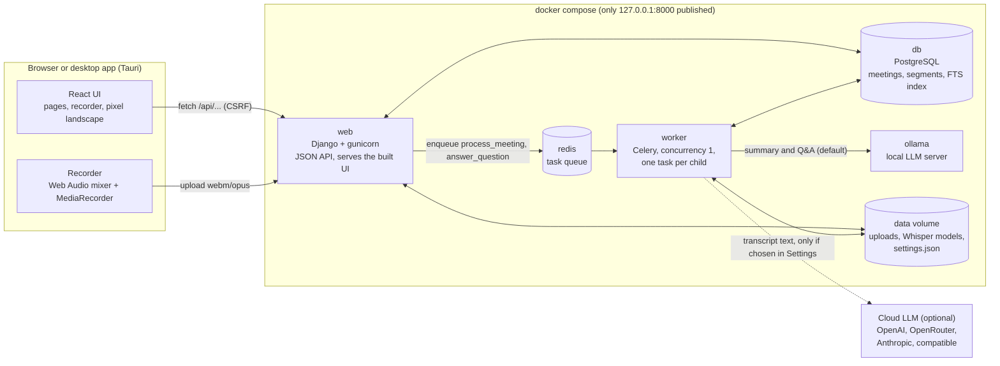
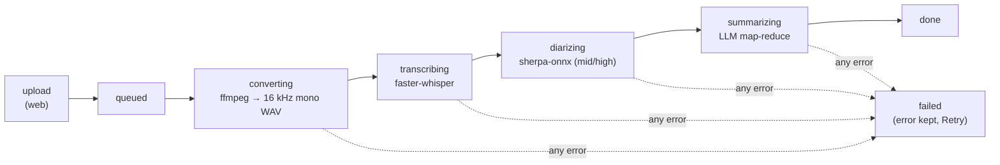
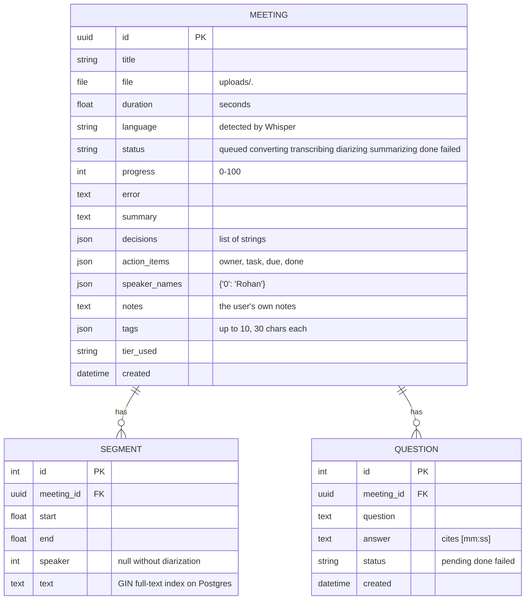

# PrivMeet architecture

PrivMeet turns a meeting recording into a transcript with speakers, a summary, decisions, action items, search and Q&A. Everything runs on the user's machine. This document describes:
- the parts of the system
- the path a recording takes through them
- how the system stays inside the memory of a low-end laptop
- the data it stores

## Components

| Part | Technology | Job |
|---|---|---|
| UI | React 19 + Tailwind 4 (Vite build) | Pages: Home, Meetings, New Meeting, Meeting detail, Record / Live, Settings. Polls the API every 2 s while a meeting is processing; there are no websockets. |
| Recorder | Web Audio + `MediaRecorder` | Mixes the mic with a shared tab's audio (`getDisplayMedia`) into one stream, records `audio/webm;codecs=opus`, uploads on stop. |
| Desktop app | Tauri 2 (system webview) | Launcher page: checks Docker, runs `docker compose up -d` with the bundled `compose.yml` (+ `compose.gpu.yml` on NVIDIA), opens the app, stops the stack on quit. Grants mic/camera to `127.0.0.1:8000` only. |
| web | Django, plain `JsonResponse` views, whitenoise | Upload validation, the meetings API, settings, search, serving the built UI. Runs no models. |
| worker | Celery | Runs the pipeline and Q&A jobs, one at a time. |
| redis | Redis 7 | The Celery broker, capped at 32 MB. |
| db | PostgreSQL 17 (SQLite in local dev) | Meetings, transcript segments, questions; a GIN full-text index on segments. |
| ollama | Ollama | Serves the qwen2.5 model of the tier; at most one model loaded. |

## The pipeline
`meetings/tasks.py: process_meeting(meeting_id)` runs these stages strictly one after another in the worker. Each stage updates `Meeting.status` and `progress`, and the UI shows them as it polls.

1. **Upload (web).** The upload is checked before it is stored:
   - extension allow-list
   - size limit (`MAX_UPLOAD_MB`), checked on the header before Django reads the body
   - `ffprobe` must find an audio stream

   The file gets a random name, a `Meeting` row is created in `queued`, and the job is put on the queue.
2. **Converting.** `pipeline/audio.py` runs `ffmpeg` (list arguments, never a shell) to a temporary 16 kHz mono WAV. Every later stage reads that file, and it is deleted at the end whatever happens.
3. **Transcribing.** `pipeline/transcribe.py` loads Whisper through faster-whisper (CTranslate2, int8 on CPU, so no PyTorch):
   - Voice activity detection skips silence.
   - Segments are streamed and saved in batches of 20, and progress follows the audio position.
   - On a CUDA profile, a failure while loading or decoding the first segment retries once on the CPU with int8.
4. **Diarizing** (on unless the tier is `low`). `pipeline/diarize.py` runs sherpa-onnx (pyannote segmentation + a CAM++ speaker embedding, about 35 MB of ONNX). Each transcript segment gets the speaker whose turns overlap it most, and speakers are renumbered in order of appearance.
5. **Summarizing.** `pipeline/llm.py` uses LangChain against Ollama, or the chosen cloud provider (`pipeline/providers.py`):
   - **Map:** the transcript is split into chunks of about 1,500 tokens. Each chunk becomes `TOPIC / DECISION / TASK: owner | task | due` lines; small models stay accurate on short chunks.
   - **Reduce:** one call writes the JSON `{summary, decisions, action_items}`. For a long meeting it reads the map notes; for a short one, the transcript itself.
   - **Repair:**
     - Decisions and tasks are taken from the map lines, so the reduce step cannot drop them.
     - A loose or cut-off JSON reply is repaired.
     - Owners and due dates that never appear in the transcript are blanked (no invented names or deadlines).
   - **Budget:** every call caps its reply, so prompt plus reply always fit `num_ctx`.
6. **Done** or **failed**. On any exception the error text is stored, the status becomes `failed`, and the UI offers Retry.

**Q&A** (`answer_question`) goes through the same queue, so it never runs next to a transcription.
- `search.excerpts` sends the whole timestamped transcript when it fits.
- Otherwise it sends the best keyword hits: Postgres full-text rank, or a word-count rank on SQLite. Each hit comes with the lines that follow it, because a topic is raised before it is decided.
- The answer must cite `[mm:ss]`. When the model leaves the citation out, the timestamps of the best-matching lines are added. An answer that shares nothing with the excerpts becomes "The meeting does not say."

**Search** (`GET /api/meetings/?q=`) matches title, notes and summary, plus the transcript through the Postgres full-text index (`SearchVector('text', 'english')`, GIN index in migration 0002), and returns the matching lines with their timestamps.

## Resource strategy
PrivMeet has to run on a laptop with about 6 GB of RAM and no GPU, and still use an NVIDIA GPU when there is one.

1. **A hardware tier, picked at start-up.** `meetings/hw.py`:
   - reads the total RAM (`/proc/meminfo`, or the OS API on Windows and macOS),
   - checks for CUDA through CTranslate2,
   - reads the VRAM through `nvidia-smi`.

   The tier sets the Whisper model and precision, the LLM and its context, the beam size and whether diarization runs. Env variables and then the Settings page override it. Settings are re-read at the start of every job, so a change applies to the next meeting with no restart.

   | | low | mid | high |
   |---|---|---|---|
   | Trigger | < 7.5 GB, no GPU | ≥ 7.5 GB, no GPU | NVIDIA GPU |
   | Whisper | base, int8, CPU, beam 1 | small, int8, CPU, beam 5 | large-v3-turbo, int8_float16, CUDA |
   | LLM | qwen2.5:1.5b, ctx 4096, unloads after 30 s | qwen2.5:3b, ctx 8192 | qwen2.5:7b, or 3b under 6 GB VRAM |
   | Diarization | off | on | on |
2. **One heavy model in memory at a time.**
   - The worker runs with `--concurrency=1 --prefetch-multiplier=1 --max-tasks-per-child=1`: one job, then the process exits and the OS gets all its memory back.
   - Inside a job the stages are sequential, and the Whisper model is dropped before diarization starts.
   - Ollama runs with `OLLAMA_MAX_LOADED_MODELS=1` and `OLLAMA_NUM_PARALLEL=1`, and Q&A shares the worker queue.
   - Measured low-tier peaks: Whisper worker 0.8 GB, then the 1.5B model 1.1 GB in Ollama, never at the same time (`docs/BENCHMARKS.md`).
3. **CPU politeness.** Whisper and the LLM use half the cores by default, the worker runs under `nice`, and voice activity detection skips silence, so the desktop and the web UI stay responsive.
4. **A light runtime.**
   - The UI is built to static files at image build time and served by Django and whitenoise, with no Node server.
   - Progress is plain polling, with no websockets.
   - Postgres has `shared_buffers=64MB`, Redis is capped at 32 MB, and every container has a `mem_limit`.
5. **Light diarization.** ONNX models through sherpa-onnx instead of pyannote on PyTorch: tens of megabytes instead of gigabytes.
6. **Long meetings on small models.** Map-reduce with chunk sizes worked out from `num_ctx`, so a one-hour meeting fits a 4k-context model (see "The pipeline").

## Data model

- **Uploads** live in the `data` volume under random file names and are only ever served through `GET /api/meetings/<id>/audio`, which supports HTTP Range so the player can seek. Deleting a meeting deletes its file. Segments and questions go with it (cascade).
- **Settings** are not in the database. They are `DATA_DIR/settings.json`, written atomically (temp file + rename) by `meetings/settings_store.py`, which validates every key and never returns the cloud API key, only `api_key_set`.
- **Per-browser preferences** live in `localStorage`, so they differ per device and never reach the server: theme, font, default microphone, tab audio, camera and recording title.

## Feature flags
`GET /api/system/` returns `features`, the list of optional capabilities this server supports (`settings`, `notes`, `tags`, `filters`, `providers`, ...). The frontend shows a control only when its flag is there. This let the backend and frontend halves of the project be built and merged independently, without broken buttons in between. Every endpoint and flag is listed in [API.md](API.md).

## Trust boundaries
- **Single user, no login.** The only published port is `127.0.0.1:8000`. Every write needs the CSRF token. The app refuses to start in production mode with the sample `SECRET_KEY`.
- **Untrusted input:**
  - Uploaded files: an allow-list, a size cap and `ffprobe`. Subprocesses take list arguments only.
  - Meeting text in the UI: React escapes it, and nothing goes through `innerHTML`.
  - Settings values: each key is type- and range-checked.
- **What leaves the machine:** nothing with the default Ollama provider, apart from downloading images and models. With a cloud provider chosen in Settings (after a warning), the transcript text of each summary and question goes to it. Audio never does.
- **Desktop app:** the Tauri shell grants microphone and camera only to the page on `127.0.0.1:8000`, and the app page gets no Tauri API.

## Deployment modes

| Mode | Command | What differs |
|---|---|---|
| Docker, CPU | `docker compose up -d`, or `scripts/privmeet.sh up` | The normal install. `web` and `worker` pull `ghcr.io/kashish1809/privmeet:${PRIVMEET_VERSION:-latest}` |
| Docker, GPU | `docker compose -f compose.yml -f compose.gpu.yml up -d` | Adds the NVIDIA device reservations for `worker` and `ollama`; the GPU image carries the CUDA runtime. The launchers add it on their own when `nvidia-smi` answers |
| Local development | `runserver` + Vite | `CELERY_EAGER=1` runs the pipeline in the web process, SQLite instead of Postgres, no Redis and no worker |
| Desktop app | Tauri 2 shell | Bundles `compose.yml` and `compose.gpu.yml`, starts the stack, then opens `127.0.0.1:8000` in the system webview |

Sources are built into the image when there is no published tag: `docker compose up --build`. The desktop app does not bundle a second copy of the UI; it is the same Django app in another window, which is why it grants the webview microphone and camera access instead of recording natively.

## Known limits

Deliberate choices, each with a comment in the code or a task that lifts it:

- Retrieval for long transcripts is keyword full-text search, not embeddings, so a question phrased with words the meeting never used can miss. Upgrade path: pgvector with an embedding model, only if recall proves poor.
- One job at a time is the point of the design, so a second meeting waits in `queued`, with no estimate of when it starts.
- A meeting that fails is reprocessed from the start with Retry; the pipeline has no resume-from-stage.
- No transcription while recording: the transcript appears once the recording stops and has been processed.
- SQLite is a development fallback. Search degrades to `LIKE` and is not ranked.
- An upload is a single multipart request capped at `MAX_UPLOAD_MB` (2 GB by default), so very long recordings are better compressed before upload.
