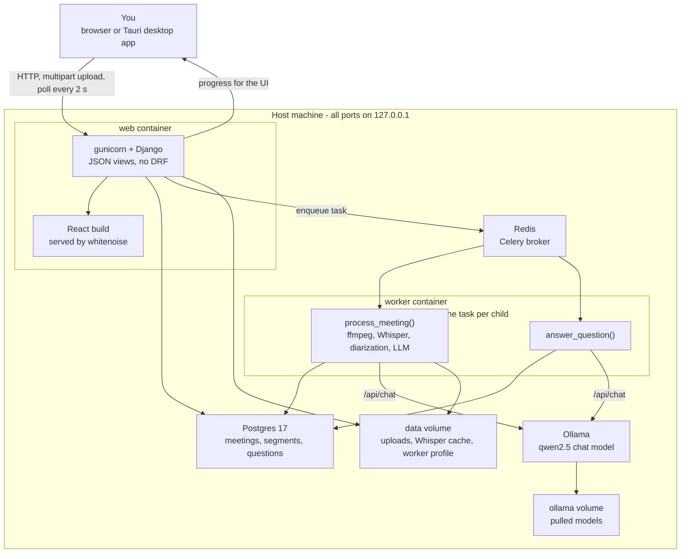
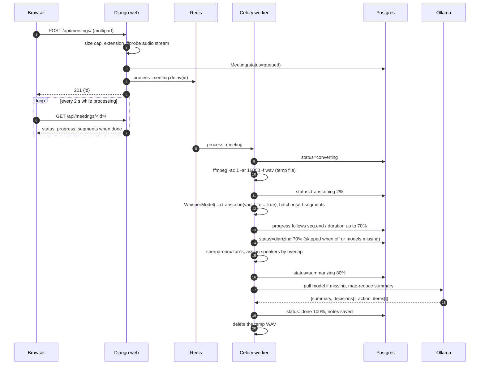

# PrivMeet architecture

How the pieces fit together, why they are split that way, and what the code guarantees.
For the task split and the current state see [TASKS.md](TASKS.md); for the original design
notes see [PLAN.md](PLAN.md). This file is written to be quotable in the project report.

## Shape of the system

One Docker Compose stack on one machine. There is no server-side worker outside it, no
external API and no login: the browser talks to Django on `127.0.0.1:8000`, and everything
expensive happens in a single Celery worker that runs one job at a time.

What each part is responsible for:

| Part | Responsibility | Not responsible for |
|---|---|---|
| React UI | Upload or record, poll progress, show transcript, notes, Q&A, search | Any processing |
| Django views | Validate uploads, persist rows, enqueue tasks, serve JSON and audio | Running the pipeline |
| Celery worker | The pipeline and Q&A, one job at a time | Serving HTTP |
| Postgres | Meetings, segments with the full-text index, questions | Anything the RAG stage needs |
| Redis | Task queue only, `maxmemory 32mb`, no persistence | Data storage |
| Ollama | The summary and Q&A model, one loaded model at a time | Whisper |

The UI holds no state that matters. `GET /api/meetings/<id>/` is the single source of truth
and the page polls it every 2 s while the meeting is processing, which is why no websocket
or Channels layer exists.

## The pipeline

`tasks.process_meeting(meeting_id)` runs four stages in strict sequence inside one worker
process. Each stage frees its model before the next one loads, so two heavy models are
never resident together.

| Stage | Status | Progress | What happens | Model in RAM |
|---|---|---|---|---|
| 0 | `queued` | 0 | Row created, task enqueued | none |
| 1 | `converting` | 0 | `ffmpeg -i in -ac 1 -ar 16000 -f wav` into a temp file; fails fast on a broken container | ffmpeg only |
| 2 | `transcribing` | 2 to 70 | faster-whisper streams segments; they are bulk-inserted every 20 rows; progress follows `seg.end / duration` | Whisper |
| 3 | `diarizing` | 70 | sherpa-onnx speaker turns, assigned to the Whisper segments by maximum time overlap. Skipped when the tier has it off or the ONNX models are missing | diarization ONNX |
| 4 | `summarizing` | 80 to 95 | Ollama pulls the tier's model on first use, then a LangChain map-reduce summarises chunks sized to `num_ctx` | chat model |
| 5 | `done` | 100 | Summary, decisions and action items saved on the meeting row | none |

Any exception sets `failed` and stores the message in `Meeting.error`, which the UI shows
with a Retry button. The temporary WAV is deleted in a `finally` block, so a failed job
never leaves a 60 MB file behind. Retry deletes the old segments and runs the whole pipeline
again.

**Q&A** is a second task, `answer_question(question_id)`, on the same queue.
It is deliberately not a view: a question asked while a transcription runs waits its turn
instead of loading a second model. `search.py` builds the prompt from the whole transcript
when it fits the context window, and otherwise from the best-matching segments plus their
neighbours. The answer cites `[mm:ss]`, and the UI turns each citation into a seek.
