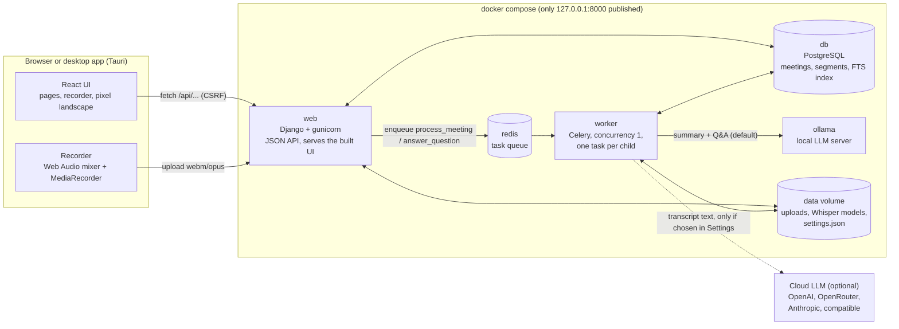
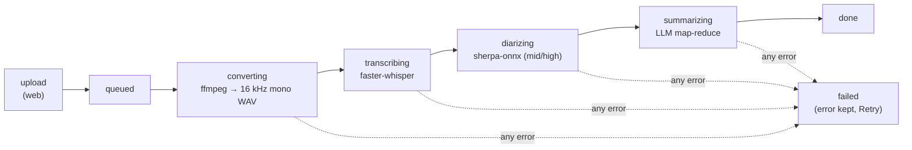

# PrivMeet architecture

PrivMeet turns a meeting recording into a transcript with speakers, a summary, decisions, action items, search and Q&A. Everything runs on the user's machine. This document describes:
- the parts of the system
- the path a recording takes through them
- how the system stays inside the memory of a low-end laptop
- the data it stores

## Components

| Part | Technology | Job |
|---|---|---|
| UI | React 19 + Tailwind 4 (Vite build) | Pages: Home, Meetings, New Meeting, Meeting detail, Record / Live, Settings. Polls the API every 2 s while a meeting is processing; there are no websockets. |
| Recorder | Web Audio + `MediaRecorder` | Mixes the mic with a shared tab's audio (`getDisplayMedia`) into one stream, records `audio/webm;codecs=opus`, uploads on stop. |
| Desktop app | Tauri 2 (system webview) | Launcher page: checks Docker, runs `docker compose up -d` with the bundled `compose.yml` (+ `compose.gpu.yml` on NVIDIA), opens the app, stops the stack on quit. Grants mic/camera to `127.0.0.1:8000` only. |
| web | Django, plain `JsonResponse` views, whitenoise | Upload validation, the meetings API, settings, search, serving the built UI. Runs no models. |
| worker | Celery | Runs the pipeline and Q&A jobs, one at a time. |
| redis | Redis 7 | The Celery broker, capped at 32 MB. |
| db | PostgreSQL 17 (SQLite in local dev) | Meetings, transcript segments, questions; a GIN full-text index on segments. |
| ollama | Ollama | Serves the qwen2.5 model of the tier; at most one model loaded. |

## The pipeline
`meetings/tasks.py: process_meeting(meeting_id)` runs these stages strictly one after another in the worker. Each stage updates `Meeting.status` and `progress`, and the UI shows them as it polls.

1. **Upload (web).** The upload is checked before it is stored:
   - extension allow-list
   - size limit (`MAX_UPLOAD_MB`), checked on the header before Django reads the body
   - `ffprobe` must find an audio stream

   The file gets a random name, a `Meeting` row is created in `queued`, and the job is put on the queue.
2. **Converting.** `pipeline/audio.py` runs `ffmpeg` (list arguments, never a shell) to a temporary 16 kHz mono WAV. Every later stage reads that file, and it is deleted at the end whatever happens.
3. **Transcribing.** `pipeline/transcribe.py` loads Whisper through faster-whisper (CTranslate2, int8 on CPU, so no PyTorch):
   - Voice activity detection skips silence.
   - Segments are streamed and saved in batches of 20, and progress follows the audio position.
   - On a CUDA profile, a failure while loading or decoding the first segment retries once on the CPU with int8.
4. **Diarizing** (on unless the tier is `low`). `pipeline/diarize.py` runs sherpa-onnx (pyannote segmentation + a CAM++ speaker embedding, about 35 MB of ONNX). Each transcript segment gets the speaker whose turns overlap it most, and speakers are renumbered in order of appearance.
5. **Summarizing.** `pipeline/llm.py` uses LangChain against Ollama, or the chosen cloud provider (`pipeline/providers.py`):
   - **Map:** the transcript is split into chunks of about 1,500 tokens. Each chunk becomes `TOPIC / DECISION / TASK: owner | task | due` lines; small models stay accurate on short chunks.
   - **Reduce:** one call writes the JSON `{summary, decisions, action_items}`. For a long meeting it reads the map notes; for a short one, the transcript itself.
   - **Repair:**
     - Decisions and tasks are taken from the map lines, so the reduce step cannot drop them.
     - A loose or cut-off JSON reply is repaired.
     - Owners and due dates that never appear in the transcript are blanked (no invented names or deadlines).
   - **Budget:** every call caps its reply, so prompt plus reply always fit `num_ctx`.
6. **Done** or **failed**. On any exception the error text is stored, the status becomes `failed`, and the UI offers Retry.

**Q&A** (`answer_question`) goes through the same queue, so it never runs next to a transcription.
- `search.excerpts` sends the whole timestamped transcript when it fits.
- Otherwise it sends the best keyword hits: Postgres full-text rank, or a word-count rank on SQLite. Each hit comes with the lines that follow it, because a topic is raised before it is decided.
- The answer must cite `[mm:ss]`. When the model leaves the citation out, the timestamps of the best-matching lines are added. An answer that shares nothing with the excerpts becomes "The meeting does not say."

**Search** (`GET /api/meetings/?q=`) matches title, notes and summary, plus the transcript through the Postgres full-text index (`SearchVector('text', 'english')`, GIN index in migration 0002), and returns the matching lines with their timestamps.
