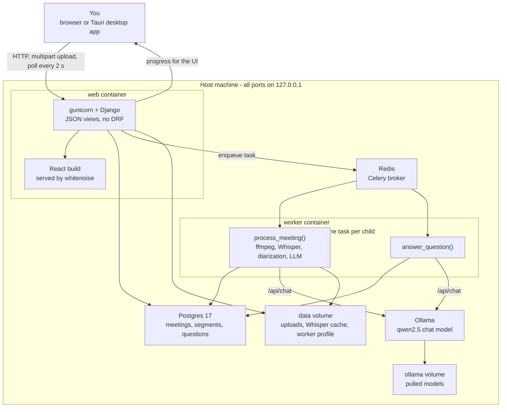
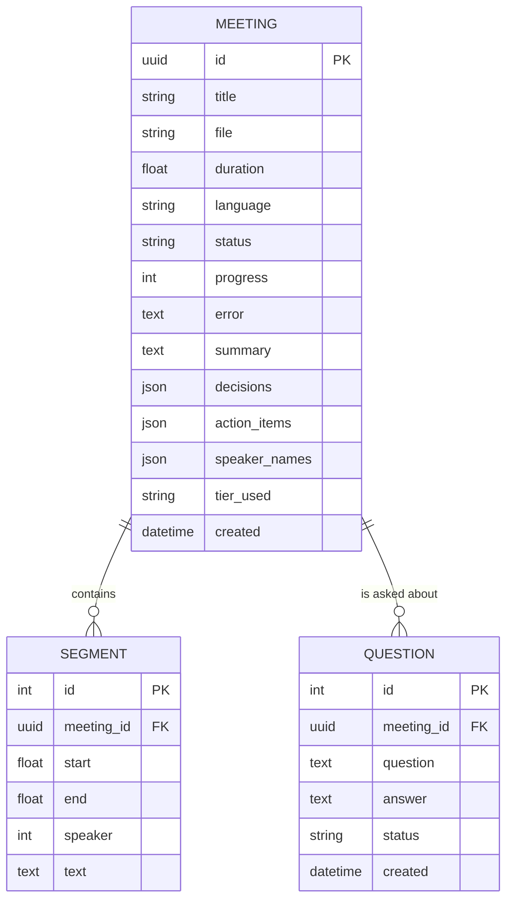

# PrivMeet architecture

How the pieces fit together, why they are split that way, and what the code guarantees.
For the task split and the current state see [TASKS.md](TASKS.md); for the original design
notes see [PLAN.md](PLAN.md). This file is written to be quotable in the project report.

## Shape of the system

One Docker Compose stack on one machine. There is no server-side worker outside it, no
external API and no login: the browser talks to Django on `127.0.0.1:8000`, and everything
expensive happens in a single Celery worker that runs one job at a time.

What each part is responsible for:

| Part | Responsibility | Not responsible for |
|---|---|---|
| React UI | Upload or record, poll progress, show transcript, notes, Q&A, search | Any processing |
| Django views | Validate uploads, persist rows, enqueue tasks, serve JSON and audio | Running the pipeline |
| Celery worker | The pipeline and Q&A, one job at a time | Serving HTTP |
| Postgres | Meetings, segments with the full-text index, questions | Anything the RAG stage needs |
| Redis | Task queue only, `maxmemory 32mb`, no persistence | Data storage |
| Ollama | The summary and Q&A model, one loaded model at a time | Whisper |

The UI holds no state that matters. `GET /api/meetings/<id>/` is the single source of truth
and the page polls it every 2 s while the meeting is processing, which is why no websocket
or Channels layer exists.

## The pipeline

`tasks.process_meeting(meeting_id)` runs four stages in strict sequence inside one worker
process. Each stage frees its model before the next one loads, so two heavy models are
never resident together.

```mermaid
sequenceDiagram
  autonumber
  participant U as Browser
  participant W as Django web
  participant Q as Redis
  participant C as Celery worker
  participant P as Postgres
  participant O as Ollama

  U->>W: POST /api/meetings/ (multipart)
  W->>W: size cap, extension, ffprobe audio stream
  W->>P: Meeting(status=queued)
  W->>Q: process_meeting.delay(id)
  W-->>U: 201 {id}
  loop every 2 s while processing
    U->>W: GET /api/meetings/<id>/
    W-->>U: status, progress, segments when done
  end
  Q->>C: process_meeting
  C->>P: status=converting
  C->>C: ffmpeg -ac 1 -ar 16000 -f wav (temp file)
  C->>P: status=transcribing 2%
  C->>C: WhisperModel(...).transcribe(vad_filter=True), batch insert segments
  C->>P: progress follows seg.end / duration up to 70%
  C->>P: status=diarizing 70% (skipped when off or models missing)
  C->>C: sherpa-onnx turns, assign speakers by overlap
  C->>P: status=summarizing 80%
  C->>O: pull model if missing, map-reduce summary
  O-->>C: {summary, decisions[], action_items[]}
  C->>P: status=done 100%, notes saved
  C->>C: delete the temp WAV
```

| Stage | Status | Progress | What happens | Model in RAM |
|---|---|---|---|---|
| 0 | `queued` | 0 | Row created, task enqueued | none |
| 1 | `converting` | 0 | `ffmpeg -i in -ac 1 -ar 16000 -f wav` into a temp file; fails fast on a broken container | ffmpeg only |
| 2 | `transcribing` | 2 to 70 | faster-whisper streams segments; they are bulk-inserted every 20 rows; progress follows `seg.end / duration` | Whisper |
| 3 | `diarizing` | 70 | sherpa-onnx speaker turns, assigned to the Whisper segments by maximum time overlap. Skipped when the tier has it off or the ONNX models are missing | diarization ONNX |
| 4 | `summarizing` | 80 to 95 | Ollama pulls the tier's model on first use, then a LangChain map-reduce summarises chunks sized to `num_ctx` | chat model |
| 5 | `done` | 100 | Summary, decisions and action items saved on the meeting row | none |

Any exception sets `failed` and stores the message in `Meeting.error`, which the UI shows
with a Retry button. The temporary WAV is deleted in a `finally` block, so a failed job
never leaves a 60 MB file behind. Retry deletes the old segments and runs the whole pipeline
again.

**Q&A** is a second task, `answer_question(question_id)`, on the same queue.
It is deliberately not a view: a question asked while a transcription runs waits its turn
instead of loading a second model. `search.py` builds the prompt from the whole transcript
when it fits the context window, and otherwise from the best-matching segments plus their
neighbours. The answer cites `[mm:ss]`, and the UI turns each citation into a seek.

## Resource strategy

This is the constraint the whole design is built around: a 6 GB machine with no GPU has to
finish a one-hour meeting without swapping, and a machine with an NVIDIA card must not be
held back by the CPU choices.

1. **A tier chosen at runtime.** `hw.py` reads `MemTotal` from `/proc/meminfo` and asks
   CTranslate2 whether CUDA is visible, then picks `low`, `mid` or `high`. Every value is
   overridable by env var, and nothing outside `hw.py` writes a model name down. A tier
   forced to `high` on a CPU-only box silently falls back to `device="cpu"`,
   `compute_type="int8"`.

   | Tier | Trigger | Whisper | Chat model | Diarization | Threads |
   |---|---|---|---|---|---|
   | low | < 8 GB, no GPU | `base` int8 | `qwen2.5:1.5b`, 4096 ctx | off | half the cores |
   | mid | >= 8 GB, no GPU | `small` int8 | `qwen2.5:3b`, 8192 ctx | on | half the cores |
   | high | NVIDIA GPU | `large-v3-turbo` float16 | `qwen2.5:7b`, 8192 ctx | on | half the cores |

2. **One heavy model in RAM, ever.** The worker runs with `--concurrency=1
   --prefetch-multiplier=1 --max-tasks-per-child=1`, so the process exits after every job
   and hands all model memory back to the OS. Inside a job the stages are sequential and
   each model is dropped before the next loads. Ollama is pinned with
   `OLLAMA_MAX_LOADED_MODELS=1` and `OLLAMA_NUM_PARALLEL=1`, and the low tier passes
   `keep_alive="30s"` so the chat model unloads soon after the summary. Q&A goes through
   the same queue, so it can never load a second model beside a running transcription.

3. **CPU politeness.** Whisper gets `max(1, cpus // 2)` threads and the worker container
   runs under `nice -n 10`, which keeps the desktop and the web UI responsive during a long
   transcription. `vad_filter=True` drops silence before decoding, which is the single
   biggest speed-up on real meeting audio.

4. **A light runtime.** React is compiled to static files at image build time and served by
   Django through whitenoise, so no Node process runs in production. Progress is polling
   (`GET /api/meetings/<id>/` every 2 s), so there is no websocket server. Gunicorn runs
   two workers; Postgres is tuned to `shared_buffers=64MB`; Redis is capped at 32 MB and
   persists nothing. Every service has a `mem_limit` in `compose.yml`.

5. **Light diarization.** `sherpa-onnx` runs two small ONNX models (pyannote segmentation
   plus a 3D-Speaker embedding, about 40 MB together) instead of pyannote's PyTorch stack,
   which alone would blow the budget. Speakers are assigned to Whisper segments by maximum
   time overlap. The models are baked into the image at build time.

6. **Long meetings on a small model.** A LangChain map-reduce chain splits the transcript
   into chunks sized at half of `num_ctx` (roughly 4 characters per token), summarises each
   chunk, then combines the partial results in a final call. `ChatOllama(format="json")`
   returns `{summary, decisions[], action_items[{owner, task, due}]}`. A 60-minute meeting
   never has to fit in one context window.

The target is a peak of about 2 GB for the whole stack on the low tier. Measured numbers
belong in the benchmark table from task T1.4; this file only states the strategy.

## Data model

Three tables, no ORM abstraction on top of them, and no vector store.

- **Meeting** holds both the job state (`status`, `progress`, `error`, `tier_used`) and the
  generated notes (`summary`, `decisions`, `action_items`, `speaker_names`). One row, one
  poll target for the UI.
- **Segment** is one Whisper utterance: `start` and `end` in seconds, `text` as the line,
  and `speaker` as a small integer index, `NULL` before diarization or when it is off.
  Speaker names are a map on the meeting (`{"0": "Alice"}`), not a table, because renaming
  is a display concern and must not rewrite every segment.
- **Question** is a Q&A job: `pending` until the worker answers, then `done` or `failed`
  with the message in `answer`.
- A GIN index on `SearchVector("text", config="english")` from migration 0002 gives
  Postgres full-text search over segments. `search.py` must build the vector with exactly
  that expression, or Postgres will not use the index.
- Uploaded files are stored under a uuid name inside `MEDIA_ROOT` and only served through
  `/api/meetings/<id>/audio`, which supports Range requests so seeking works.

## Deployment modes

| Mode | Command | What differs |
|---|---|---|
| Docker, CPU | `docker compose up -d` | The normal install. Images from GHCR |
| Docker, GPU | `docker compose -f compose.yml -f compose.gpu.yml up -d --build` | Adds the NVIDIA device reservations and builds the worker with `GPU=1` |
| Local development | `runserver` + Vite | `CELERY_EAGER=1` runs tasks in the web process, SQLite instead of Postgres, no Redis |
| Desktop app | Tauri 2 shell | Bundles its own `compose.yml`, starts the stack, then opens `127.0.0.1:8000` in the system webview |

The desktop app does not bundle a second copy of the frontend: it is the same Django app in
a different window. That is also why recording inside the app needs the webview's media
permission (Kashish's A2.4), not a native recorder.

## Trust boundaries

- **No authentication.** Single-user by design, so the only defense is the address: the
  stack publishes `127.0.0.1:8000` and nothing else, and Ollama and Postgres publish no port
  at all. `compose.yml` states this at the top for anyone tempted to change it.
- **Uploads are untrusted.** Extension allowlist, `MAX_UPLOAD_MB` cap before reading the
  body, then `ffprobe` must find a real audio stream. Files are stored under a uuid name.
- **CSRF is on** for every POST, PATCH and DELETE, with the token from the `csrftoken`
  cookie. The frontend sends it through the `api.js` helpers; no view turns it off.
- **Subprocesses use list arguments**, never `shell=True`, and the only file paths passed to
  them are generated by the server.
- **`SECRET_KEY` is mandatory** when `DEBUG` is off: `settings.py` raises at startup rather
  than run with the public development key.
- **No outbound traffic at runtime** except pulling Docker images and the two model
  downloads. Meeting audio and text never leave the machine.

## Known limits

These are deliberate, each with a note in the code or a task that lifts it:

- Retrieval for long transcripts is keyword full-text search, not embeddings. Upgrade path:
  pgvector with `nomic-embed-text`, only if recall proves poor.
- One job at a time is the point of the design, so a second meeting waits in `queued`. The
  UI shows queue position once the `cancel` flag exists.
- A meeting that fails has to be reprocessed from the start (or re-summarised, with the
  `summarize` flag) rather than resumed.
- No live transcription while recording; the transcript appears when the recording stops.
- SQLite is a development fallback. Search degrades to `LIKE` and is not ranked.
- Uploads are a single multipart request, capped at `MAX_UPLOAD_MB` (2 GB by default). Very
  long recordings are better compressed before upload.